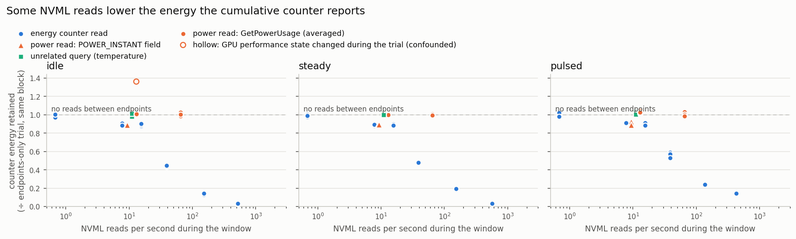

# NVML energy-counter validation (Milestone 4)

**Question.** On the development host, does reading NVML change the energy
that the cumulative counter (`nvmlDeviceGetTotalEnergyConsumption`) reports,
and if so, what follows for this profiler and for the historical research
measurements?

**Short answer.** Yes, on this host. Each read of the energy counter, and of
the instantaneous-power field, removes roughly 9–11 ms of energy accumulation
from the counter, for every reader, at every power level tested. Reading the
averaged power (`GetPowerUsage`) or the temperature does not. The sampler's
10 Hz reads therefore lower the counter by ~10–11%. Which of the undisturbed
counter and the power sensor is closer to the true energy cannot be decided
without an external meter; they differ by 2–4%.

Everything below comes from one RTX 4090 under WSL2 with driver 610.88, plus
read-only analysis of the frozen research runs (driver 591.86, same GPU).

## 1. Audit of the existing measurement path

| Component | What it does | Relevant finding |
|---|---|---|
| `sampling.sample_row` | at ~10 Hz: `time.time()`, then `GetPowerUsage` and `GetTotalEnergyConsumption` per GPU | 10 energy reads/s → the counter it records is lowered by ~10% (section 3) |
| `events.mark` (v1), `Session` (v2) | one energy read at each span boundary | frequent short spans add reads; on the current driver each read costs ~10 ms of accumulation |
| power integration (`integrate_gpu`) | trapezoid over sampled `GetPowerUsage` | `GetPowerUsage` equals the driver's *averaged*-power field (`NVML_FI_DEV_POWER_AVERAGE`), not the instantaneous one; it lags load changes (section 4) |
| timestamps | the sampler stamps a row before its reads; reads take 0.1–1.2 ms | alignment error ≤ ~1 ms per sample; cannot produce a 10% bias over long windows |
| `validation.probe_nvml_resolution` | polls every ~2 ms to time counter updates | interval is valid; the reported median *step* is itself disturbed (155 mJ at idle vs ~2.6 J undisturbed) |
| frozen runs | sampler at 10 Hz + in-band reads at events | counter ÷ integrated power 0.864–0.876 (section 5) |

The NVIDIA Developer Forum thread on this API
(<https://forums.developer.nvidia.com/t/value-from-nvmldevicegettotalenergyconsumption-seems-to-be-off-by-a-factor/336318>)
reports an idle RTX 6000 Ada (driver 555.42.06, OS not stated) whose counter
ran 37–56% below power × time with reads every 5 s, and a later reply that the
deficit grows with more `nvmlDeviceGetPowerUsage` calls. There is no NVIDIA
response. Our results agree that reads matter but differ in detail: here
1 Hz energy reads have no detectable effect and `GetPowerUsage` none at all.

## 2. Experiment

`tools/nvml_diagnostics/experiment.py`; raw data `results/nvml_m4/`.

- 12 conditions, each an 8 s window bounded by two energy-counter reads
  taken identically in every condition; only the NVML calls *inside* the
  window differ (none; temperature; `GetPowerUsage` 10/50 Hz; power-instant
  field 10 Hz; energy counter 1/10/50/200/~1000 Hz; energy via the field-value
  API 10 Hz; power + energy at 10 Hz like the sampler).
- 4 blocks per workload, conditions shuffled per block (seed 20261015), 3 s
  without reads before every trial, 30 s warm-up.
- Workloads in a separate process: idle (~27 W), steady matmul (~431 W),
  pulsed matmul 0.3 s on / 0.3 s off (~254 W). Within the 83 °C abort limit
  throughout (max 79 °C).
- The primary comparison is counter against counter: each trial divided by
  the read-free trial of its block. No assumption about which instrument is
  correct enters it.

## 3. Results

Counter energy retained relative to the read-free window (mean ± 95% CI over 4
blocks; full tables in `results/nvml_m4/summary.md`):

| Reads inside the window | idle | steady | pulsed |
|---|---|---|---|
| none (`endpoints`) | 1 | 1 | 1 |
| temperature, 10 Hz | 1.003 ± 0.026 | 1.003 ± 0.012 | 1.020 ± 0.020 |
| `GetPowerUsage`, 10 Hz | 1.011 (median)¹ | 0.999 ± 0.002 | 1.027 ± 0.023 |
| `GetPowerUsage`, 50 Hz | 1.004 ± 0.026 | 1.003 ± 0.009 | 1.006 ± 0.030 |
| power-instant field, 10 Hz | 0.888 ± 0.016 | 0.897 ± 0.018 | 0.904 ± 0.030 |
| energy counter, 1 Hz | 0.995 ± 0.025 | 0.991 ± 0.019 | 0.997 ± 0.030 |
| energy counter, 10 Hz | 0.894 ± 0.013 | 0.894 ± 0.003 | 0.903 ± 0.027 |
| energy via field API, 10 Hz | 0.888 ± 0.021 | 0.896 ± 0.021 | 0.904 ± 0.012 |
| power + energy, 10 Hz (sampler pattern) | 0.886 ± 0.022 | 0.895 ± 0.012 | 0.895 ± 0.020 |
| energy counter, 50 Hz | 0.443 ± 0.016 | 0.477 ± 0.010 | 0.564 ± 0.040 |
| energy counter, ~190 Hz | 0.138 ± 0.012 | 0.189 ± 0.005 | 0.248 ± 0.011 |
| energy counter, ~550–730 Hz | 0.034 ± 0.007 | 0.038 ± 0.007 | 0.146 ± 0.011 |

¹ One idle block of this condition had the GPU leave idle (P-state 8 → 5,
62 W peak), most likely Windows host activity. Counter and power both
registered it (ratio 0.996). Excluding it, the median is 1.011; the trial is
flagged in the data rather than removed.

Further observations:

- **The loss is a fraction, not a fixed amount per read**: 10 Hz retains
  ~0.89–0.90 at 27 W, 254 W and 431 W alike.
- **About 10 ms per read.** (1 − retained) ÷ reads per second gives the
  accumulation lost per read: 10.6 / 11.2 ms (idle, 10 / 50 Hz), 10.6 / 10.5
  ms (steady), 9.7 / 8.9 ms (pulsed). At higher rates the losses saturate,
  as overlapping ~10 ms losses would.
- **Updates continue, smaller.** The counter still changes every ~100 ms under
  any read rate; each change is smaller (idle 10 Hz: 2.57 J per update; 50 Hz:
  1.35 J; ~1 kHz: 0.08 J).
- **Cross-process.** In M3, a process polling quickly lowered what a second
  process saw between its own two reads. The effect is in the driver's
  counter, not per client.
- **No carry-over.** The read-free trial immediately after ≥ 50 Hz polling
  was within the spread of the other read-free trials in all three workloads.
- **Undisturbed counter vs averaged power.** With `GetPowerUsage` read (which
  does not disturb the counter), counter ÷ integrated power is 0.979 ± 0.022
  (idle), 0.966 ± 0.012 (steady), 0.977 ± 0.023 (pulsed). The two internal
  instruments disagree by 2–4% even undisturbed.
- **Quick check.** `aep validate --counter-disturbance` reproduced the effect
  in 30 s: DISTURBED, retained 0.893 (0.893, 0.889, 0.894).

## 4. The M3 contradiction (counter above integrated power)

In the M3 GPU example the counter (516 J) exceeded integrated sampled power
(499 J) although the sampler was reading the counter. Step test
(`tools/nvml_diagnostics/step_response.py`, `results/nvml_m4/step_response.json`):
over the first 3 s after the GPU goes from idle to ~445 W, counter ÷ integrated
`GetPowerUsage` is 1.025–1.055 (5 trials), against 0.966 in steady state. The
first power read after the step shows 160–220 W while the board is already at
full load: `GetPowerUsage` is a trailing average and lags. Integrated averaged
power therefore under-counts short or ramping windows, which is enough to put
it below a disturbed counter in a 3.8 s session. This is consistent with,
not a proof of, the cause in that specific run.

## 5. The frozen research runs (read-only)

| Run | counter ÷ integrated power, median (IQR) | in-band reads/s, median | Spearman(ratio, read rate) |
|---|---|---|---|
| CoR | 0.871 (0.863–0.875) | 6.1 | −0.49 |
| PoG | 0.870 (0.862–0.876) | 6.2 | −0.16 |
| ToG | 0.877 (0.873–0.879) | 4.5 | −0.58 |

- The level matches today's sampler condition (0.851–0.867 counter ÷
  integrated power), i.e. ~10% from the sampler's 10 Hz reads on top of the
  2–4% undisturbed gap.
- Trajectories with more in-band reads have slightly lower ratios, but the
  slope (ToG: 0.879 → 0.873 from 3.2 to 7.1 reads/s, ≈1.5 ms per read) is far
  smaller than the ~10 ms per read measured now. Possible reasons, not
  separable here: the older driver (591.86) behaved differently; in-band reads
  that fall within ~10 ms of a sampler read share its loss; event-boundary
  reads come in near-simultaneous pairs.
- Under the current-driver model, the research GPU energies would be ~10–14%
  lower than undisturbed counter energy. That is an *inference*: the driver
  differs, the in-band contribution does not match, and it is unknown
  whether the undisturbed counter or the power sensor is closer to true
  energy.

## 6. Hypotheses

| Hypothesis | Verdict on this host | Evidence |
|---|---|---|
| H1 Reading the energy counter (or instantaneous power) lowers what it accumulates | **supported** | dose–response across 5 rates and 3 workloads, both energy APIs, identical endpoints, randomized order, ~10 ms per read |
| H2 The power sensor over-reads, the counter is right | **not the cause of the read effect**; residual 2–4% open | the read effect is a counter-vs-counter comparison that involves no power reading; undisturbed counter and averaged power still differ 2–4%, direction of truth unknown |
| H3 Timing, alignment or window artifacts | **ruled out as the cause** | equal windows (checked), same endpoints, endpoint quantization ≤ ~1.2% and symmetric; cannot give a rate-dependent 10–97% effect |
| H4 Our own CPU activity changes GPU power | **ruled out** | temperature queries at the same rate: no effect; `GetPowerUsage` at 50 Hz: no effect; board power unchanged during disturbing reads |
| H5 Workload drift or carry-over | **ruled out** | counterbalanced blocks, tight read-free baselines (idle 27.1–28.0 W), no carry-over, P-state changes flagged |
| H6 `GetPowerUsage` lag explains disagreements in short windows | **supported** for step changes | step test: ratio 1.03–1.06 after a step vs 0.97 steady |
| H7 Specific to WSL2 | **untested** | needs bare metal; the forum report may be bare metal but differs in detail |
| H8 Specific to this driver | **partly** | the frozen runs (591.86) show the sampler-level effect but a much weaker per-read in-band effect |

## 7. What can and cannot be concluded

Established on this host (WSL2, driver 610.88):

- Energy-counter reads and instantaneous-power reads lower the counter, by
  ~10 ms of accumulation per read, for every reader; averaged-power and
  temperature reads do not.
- A 10 Hz sampler lowers the counter ~10–11%; per-span reads add more for
  frequent spans.
- Integrated averaged power lags load steps.

Requires bare-metal Linux, other drivers, or an external reference:

- Whether the effect exists outside WSL2 and on other driver versions.
- Which of the undisturbed counter and the power sensor is accurate (2–4%
  apart), and therefore the absolute bias of any figure.
- Whether the historical runs were biased by the current-driver amount.

## 8. Recommendations (not yet implemented)

Production behaviour is unchanged until these are decided.

1. **Default sampler: stop reading the energy counter at 10 Hz.** Record
   counter values at run and session boundaries (or ≤ 1 Hz, where no effect was
   detectable), and sample `GetPowerUsage` for the time series.
2. **Per-span counter reads only where spans are long.** On a disturbing host,
   in-band reads should be opt-in, or replaced by attribution from a sparsely
   read counter plus the power timeline, with the method recorded.
3. **Run `aep validate --counter-disturbance` on every host** and record the
   verdict in the session header; attach it to every report.
4. **Treat integrated `GetPowerUsage` as an estimate with known lag**; never a
   reference for short windows.
5. **No correction factor.** The per-read loss depends on read timing and
   driver; dividing by 0.89 would trade one unvalidated number for another.
6. **Historical research figures are not changed.** Report them as counter
   values recorded under a 10 Hz sampler, with this document as the caveat.

## 9. Bare-metal validation requirements

To settle H2, H7 and H8:

1. A bare-metal Linux host, same GPU model if possible, two or more driver
   versions (including 591.86 and 610.88 or later).
2. An external reference: PCIe-slot plus auxiliary-connector power measured
   by an inline meter (e.g. a riser with shunts or a PCAT-style adapter) at
   ≥ 1 kHz, time-synchronised with the host.
3. `experiment.py` unchanged (all 12 conditions, idle / steady / pulsed),
   plus `step_response.py`, with the external meter's energy over each trial
   window.
4. Pass criteria: undisturbed counter within ±2% of the external meter over
   8 s windows; `GetPowerUsage` integration within ±5% in steady state; the
   read effect present or absent with the same CI width as here.
5. Then the same on the RAPL side (CPU package / DRAM), which has never been
   measured on real hardware in this project.
